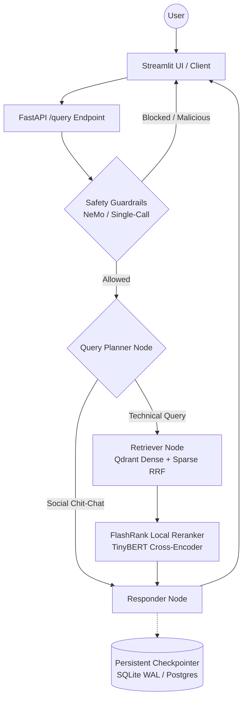

# TrustRAG: Enterprise-Grade Agentic RAG Platform

Answers grounded in your technical documentation (Kubernetes, Redis, Databricks, systems and networking), with sources. Built with **LangGraph**, **FastAPI**, **Qdrant Hybrid Search**, **Portkey / LiteLLM Gateway**, and dual-layer **Safety Guardrails** (NVIDIA NeMo & Single-Call Guard). 

The system distinguishes between technical target documentation and noisy enterprise background files using native hybrid search (Dense + Sparse BM25 RRF), cross-encoder semantic reranking, intent-aware query planning, and persistent multi-turn conversational memory.

---

## Key Features

- **Agentic Orchestration**: LangGraph state graph with cyclic reasoning, standalone query bypass, multi-step planning, and multi-turn conversational persistence.
- **Dual-Layer Safety Guardrails**: Switchable between **NVIDIA NeMo Guardrails** (Colang flows) and an optimized **Single-Call JSON Guard** with automated repair and strict fail-closed safety (100% attack detection, saving 58.2% tokens).
- **Resilient LLM Gateway**: Portkey / LiteLLM routing with automatic, dynamic fallback across secondary Groq keys and models to eliminate 429 rate-limit outages.
- **Native Hybrid Search & Reranking**: Qdrant Cloud dense vector search (`all-mpnet-base-v2` or Gemini 3072-dim) combined with FastEmbed BM25 sparse lexical search via Reciprocal Rank Fusion (RRF), followed by local **FlashRank (TinyBERT)** cross-encoder reranking.
- **Heterogeneous Document Ingestion**: Ingests `.pdf`, `.docx`, `.pptx`, `.html`, `.md`, and `.txt` locally on-device with section-aware chunking, small-fragment merging, and SHA-256 deduplication.
- **Persistent Conversational Memory**: SQLite checkpointer with Write-Ahead Logging (WAL) enabled for local concurrency, and drop-in connection-pooled `PostgresSaver` support for cloud scale.
- **Full Distributed Observability**: End-to-end distributed tracing across all agent nodes and LLM requests via **Pydantic Logfire** and **LangSmith**.
- **Rigorous Evaluation Suite**: 37-question retrieval test set, 22-case guardrail benchmark, and comprehensive audit logs documented in [RESULTS.md](RESULTS.md).

---

## Agent Intelligence Flow



> [!NOTE]
> **Checkpointer Architecture & Concurrency:**
> By default, conversation states are saved to a persistent SQLite database (`checkpoints.db`) with Write-Ahead Logging (WAL) enabled (`PRAGMA journal_mode=WAL;`). SQLite is intended for local single-worker development. For multi-worker or containerized production autoscaling, set `DATABASE_URL=postgresql://...` to enable connection-pooled `PostgresSaver`.
>
> **Security Notice (Demo Limitation):** `thread_id` in `/query` requests is client-supplied. In an enterprise production deployment, bind thread IDs to authenticated JWT session tokens.
>
> **Maintenance & Thread Pruning:** Run `python scripts/prune_checkpoints.py --days 14` to prune old conversations and reclaim disk space.

---

## Project Structure

```text
├── app/
│   ├── agents/          # LangGraph state machine & nodes (Planner, Retriever, Responder)
│   │   ├── nodes/       # Node implementations & prompt routines
│   │   ├── graph.py     # StateGraph definition & compilation
│   │   └── persistence.py # SQLite WAL / Postgres checkpointer singletons
│   ├── gateway/         # Portkey & LiteLLM client with dynamic key fallback
│   ├── guardrails/      # NeMo Guardrails (Colang) & Single-Call fail-closed guard
│   ├── ingestion/       # Document loaders (PDF, DOCX, PPTX, HTML, TXT) & chunkers
│   ├── services/        # Embeddings (Gemini / sentence-transformers) & Qdrant hybrid retrieval
│   ├── config.py        # Centralized Pydantic settings & environment configuration
│   └── main.py          # FastAPI server & /query endpoint
├── DATA/                # True technical documentation & noisy corpus
├── DOCS/                # Complete architectural & operational guides (11 comprehensive docs)
├── evals/               # Evaluation datasets, benchmark runners, & evaluation Streamlit app
├── ui/                  # Trust RAG Streamlit web interface with real-time reasoning logs
├── evals/results/       # Machine-readable evaluation outputs & token measurement logs
├── scripts/             # CLI evaluation, secret purging, and inspection utilities
└── requirements.txt     # Pinned Python dependencies
```

---

## Tech Stack

| Layer | Technology | Purpose |
|-------|------------|---------|
| **Orchestration** | LangGraph & LangChain | Cyclic state graph, conditional edges, & conversational routing |
| **LLMs & Gateway** | Groq (`openai/gpt-oss-120b`, `qwen/qwen3.8-27b`) via **Portkey / LiteLLM** | High-throughput generation with automatic secondary key fallback |
| **Safety Guardrails** | NVIDIA NeMo Guardrails & Single-Call Guard | Prompt injection, jailbreak, and off-topic defense with fail-closed JSON repair |
| **Vector DB** | Qdrant Cloud | Native hybrid search: dense vectors + sparse lexical BM25 (RRF fusion) |
| **Embeddings** | Gemini (`gemini-embedding-2-preview`) or `all-mpnet-base-v2` + FastEmbed BM25 | 3072-dim or 768-dim dense embeddings + sparse lexical vectors |
| **Semantic Reranking** | FlashRank (`ms-marco-TinyBERT-L-2-v2`) | Local, CPU-efficient cross-encoder reranking |
| **Document Parsers** | `pypdf`, `pdfplumber`, `python-docx`, `python-pptx`, `bs4` | 100% on-device document extraction without external cloud OCR |
| **Observability** | Pydantic Logfire & LangSmith | Distributed tracing, span capture, and token telemetry |
| **UI** | Streamlit | Chat interface with reasoning steps, memory clearing, & source transparency |

---

## Getting Started

### 1. Install dependencies

```powershell
# Clone the repository
git clone https://github.com/LalitChaudhari851/TrustRAG.git
cd TrustRAG

# Create and activate virtual environment
python -m venv .venv
.\.venv\Scripts\activate

# Install dependencies
pip install -r requirements.txt
```

### 2. Configure environment

Create a `.env` file in the root directory (refer to [DOCS/05_ENVIRONMENT_VARIABLES.md](DOCS/05_ENVIRONMENT_VARIABLES.md)):

```env
# Groq Reasoning Engine & Responder
GROQ_API_KEY="gsk_..."
GROQ_FALLBACK_API_KEY="gsk_..."        # Secondary key for automatic failover
GROQ_MODEL="qwen/qwen3.8-27b"          # Demo responder model (or "openai/gpt-oss-120b")

# Guardrail Configuration ("single_call" [default] or "nemo")
GUARD_MODE="single_call"
GUARDRAIL_MODEL="openai/gpt-oss-20b"   # Dedicated guardrail model verified on Groq

# Retrieval & Routing
RETRIEVAL_MODE="rrf"                   # "tinybert", "rrf", or "fusion"
QUERY_REWRITE="followup_only"          # "followup_only" or "always"

# Portkey LLM Gateway
PORTKEY_API_KEY="pk_..."

# Qdrant Vector Cloud
QDRANT_API_KEY="..."
QDRANT_CLUSTER_ENDPOINT="https://your-cluster.cloud.qdrant.io:6333"

# Observability
LOGFIRE_TOKEN="..."
LANGSMITH_TRACING=true
LANGSMITH_API_KEY="..."
LANGSMITH_PROJECT="TrustRAG"

# UI & Services
BACKEND_URL="http://localhost:8000"
```

### 3. Run data ingestion

Parses documents from `DATA/`, performs section-level chunking, and indexes dense + sparse vectors into Qdrant:

```powershell
python -m app.ingestion.processor DATA --wipe
```

### 4. Launch the application

```powershell
# Terminal 1 — FastAPI Backend (Port 8000)
uvicorn app.main:app --port 8000

# Terminal 2 — Streamlit Chat UI (Port 8501)
streamlit run ui/app.py
```

Open **[http://localhost:8501](http://localhost:8501)** in your browser.

### 5. Web Interface (Streamlit Demo UI)

The TrustRAG interactive UI provides grounded question answering, numbered source citation cards, safety alerts, and developer inspection:

- **Active Model Configuration**: The demo and UI run by default on `GROQ_MODEL=qwen/qwen3.8-27b` (reasoning engine) and `GUARDRAIL_MODEL=openai/gpt-oss-20b` (dedicated safety guardrail), with startup model catalog validation against Groq to prevent silent fallback.
- **Local Feedback Storage**: User thumbs up/down feedback is stored locally in SQLite (`feedback/feedback.db` via `POST /v1/feedback`) to keep telemetry on-premises.
- **SSE Token Streaming**: The UI connects to `POST /v1/chat/stream` with real-time token rendering (`st.write_stream`) and stage progression (`guard` -> `retrieval` -> `generating`).

#### Interface Layout

```text
+-----------------------------------------------------------------------------------+
| 🛡️ TrustRAG                                                                       |
| Answers grounded in your technical documentation (Kubernetes, Redis, Databricks)  |
|                                                                                   |
| 👤 How do you start Redis for a Kubernetes work queue?                            |
| 🛡️ To start Redis for a Kubernetes work queue, apply the Redis deployment [1]...  |
|                                                                                   |
| 📚 Sources & Citations (1)                                                        |
|   [1] parallel_work_queue.txt · OVERVIEW · p.None                                 |
|   ```text                                                                         |
|   kubectl apply -f https://k8s.io/examples/application/job/redis/redis-service.yaml|
|   ```                                                                             |
|                                                                                   |
| 🛠️ Developer details                                                              |
|   Model: qwen/qwen3.8-27b | Latency: 1240 ms | TTFT: 480 ms | Mode: tinybert       |
|                                                                                   |
| 👍 👎                                                                             |
+-----------------------------------------------------------------------------------+
```

*(Screenshot placeholder: `docs/images/trustrag_ui_main.png`)*

> [!NOTE]
> **Prototype UI Limitations**:
> The current Streamlit interface is an operational prototype and auditing tool. A production enterprise deployment would replace Streamlit with an enterprise React/Next.js frontend, Single Sign-On (SSO / SAML / OIDC authentication), token streaming with edge caching, and centralized multi-tenant RBAC.

---

## Known Limitations & Production Caveats

1. **Corpus Ingestion Disparity**: The noisy background corpus (`DATA/noisy_data`, 58 documents, 5,871 chunks in Qdrant) was indexed under chunking policy `v3.0-tokenguard-drop`, where text fragments under 15 tokens were discarded. The technical target corpus (`DATA/true_data`, 6 documents, 197 chunks in Qdrant) was indexed under chunking policy `v3.1-tokenguard-merge-384max`, where fragments under 15 tokens are merged into preceding headers/sections to guarantee 100% source text and command completeness (e.g. CLI pipelines like `redis-cli`, `rpush`, `lrange`).
2. **Document Parsing (No OCR)**: Document parsing operates locally via `pypdf`, `pdfplumber`, `python-docx`, and `python-pptx` without an optical character recognition (OCR) engine. Scanned raster PDFs or bitmap diagram texts in the corpus are not extracted.
3. **Free-Tier LLM Quotas & Capacity**: Groq enforces rate limits on `openai/gpt-oss-120b` of **1,000 requests/day** and 8,000 tokens/minute (daily token quota is **not measured** by provider response headers). With standalone technical query planner bypass:
   - Request-based capacity: assumes 2 requests/turn in `GUARD_MODE=single_call` yielding **500.0 turns/day** vs **250.0 turns/day** for NeMo (4 requests/turn).
   - Token-based capacity: assumes 200k tokens/day; not measured for this model. single_call consumes 1,259.8 tokens/turn (**158.8 turns/day**) vs 3,014.2 tokens/turn for multi-step NeMo (**66.4 turns/day**).
4. **Development Set Evaluations & Model Identification**:
   - **37-Question App Eval (Dev Set)**: Evaluated across `tinybert`, `rrf`, and `fusion` on `openai/gpt-oss-120b` (responder & single-call guard). Achieved 100% retrieval invocation (37/37) with 0 ungrounded answers.
   - **22-Case Guardrail Eval (Dev Set)**: Evaluated on `openai/gpt-oss-120b` across 7 domain queries and 15 adversarial attacks (100% accuracy).
   - **Guardrail Findings & Root Cause for G03 & H19**: In 10-trial benchmark runs at temperature 0, the original `single_call` implementation set `max_tokens=40`, causing `openai/gpt-oss-120b`'s reasoning/thought tokens to exceed the completion limit and return empty output `""` (10/10 runs returning `None`, failing closed as blocked). Increasing completion limit to `max_tokens=150` and expanding system prompt scope to explicitly include Redis work queues and Kubernetes scheduler/policy engines resolved the issue (10/10 allow for both G03 and H19).
5. **Retrieval Limitation (H03/H04 on TinyBERT)**: Default `RETRIEVAL_MODE=tinybert` fails H03 and H04 because the cross-encoder reranker scores the target sections below top-5 despite vector retrieval finding them. `RETRIEVAL_MODE=rrf` or `RETRIEVAL_MODE=fusion` are recommended pending held-out evaluation.
6. **NeMo Intent Classification Limitation with Instruction Models**: In NVIDIA NeMo Guardrails (`GUARD_MODE=nemo`), input classification prompts the underlying model via few-shot examples to output an exact intent tag (e.g. `attempt jailbreak`). Smaller instruction-tuned models (such as `qwen/qwen3.8-27b`) frequently emit conversational refusal text directly (e.g. `"I cannot fulfill that request..."`) rather than the intent label string. NeMo interprets this conversational response as an unrecognized user intent, which bypasses the Colang `jailbreak protection` flow and results in the guard failing open if downstream checks do not intercept it. For this reason, `GUARD_MODE=single_call` is configured as the production default; it enforces a strict JSON schema (`{"decision": "block", "reason": "jailbreak"}`) with deterministic Pydantic validation and strict fail-closed fallbacks.

---

## Documentation Index

| # | Guide | What it covers |
|---|-------|----------------|
| 01 | [System Overview](DOCS/01_SYSTEM_OVERVIEW.md) | High-level vision and end-to-end flow |
| 02 | [Ingestion Engine](DOCS/02_INGESTION_ENGINE.md) | Document parsing and indexing pipeline |
| 03 | [Node Intelligence](DOCS/03_NODE_INTELLIGENCE.md) | Planner, Retriever, Responder internals |
| 04 | [Observability](DOCS/04_TRACING_AND_OBSERVABILITY.md) | Logfire + LangSmith tracing |
| 05 | [Environment Variables](DOCS/05_ENVIRONMENT_VARIABLES.md) | All env vars and configuration reference |
| 06 | [Known Gotchas](DOCS/06_KNOWN_GOTCHAS.md) | Non-obvious bugs and architectural decisions |
| 07 | [FlashRank Reranking](DOCS/07_FLASHRANK_RERANKING.md) | Local semantic reranker deep-dive |
| 08 | [Guardrails](DOCS/08_GUARDRAILS.md) | NeMo Guardrails & Single-Call architecture |
| 09 | [LLM Gateway](DOCS/09_LLM_GATEWAY.md) | Portkey routing, fallback, and observability |
| 10 | [Evals & Benchmarks](DOCS/10_EVALS.md) | RAGAS metrics theory and token budget |
| 11 | [Evals Pipeline](DOCS/11_EVALS_PIPELINE.md) | Live eval pipeline and Streamlit demo |
| 12 | [Results & Audit](RESULTS.md) | Full empirical benchmarks, latency, & quota results |

---

*Built for High-Scale Enterprise Document Intelligence with Verifiable Safety.*

